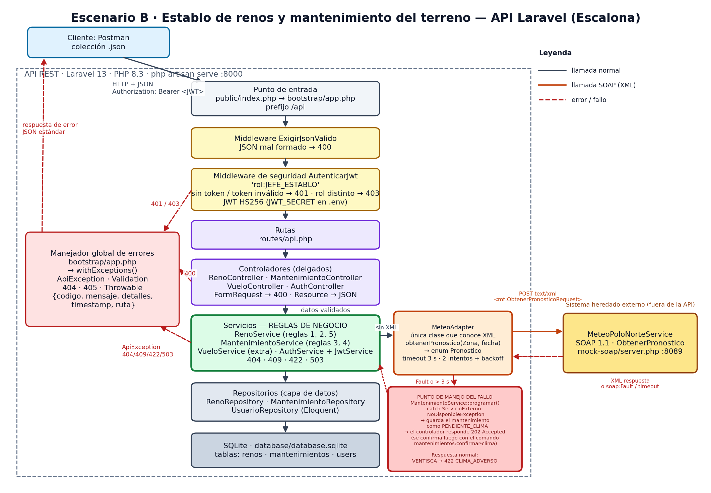

# 🦌 API Establo del Polo Norte — Parcial 1 · Escenario B

**Estudiante:** Escalona Pihuave Mauricio Herberth (N.º 10) · **Escenario:** B · Establo de renos y mantenimiento del terreno
**Stack:** PHP 8.3 · Laravel 13 · SQLite · JWT (HS256) · SOAP (MeteoPoloNorteService)

API REST para gestionar los renos, su asignación al vuelo del 24 de diciembre y el mantenimiento del terreno. Antes de programar trabajos en la pista se consulta el servicio SOAP heredado **MeteoPoloNorteService**; si falla, la API **no** responde 500: guarda el mantenimiento como `PENDIENTE_CLIMA` y responde **202 Accepted**.

---

## 1. Cómo levantar el proyecto

Requisitos: PHP 8.3 con extensiones `pdo_sqlite`, `dom`, `curl`, `mbstring`; Composer 2.

```bash
git clone <URL-del-repositorio> escalona && cd escalona
composer install
cp .env.example .env
touch database/database.sqlite
php artisan key:generate
php artisan jwt:secret            # genera JWT_SECRET en .env (no se sube al repo)
php artisan migrate:fresh --seed  # crea tablas, usuarios de prueba y 8 renos ya asignados
```
> Atajo: `composer run setup` hace `install`, copia `.env`, crea la base y genera APP_KEY y JWT_SECRET. Luego `php artisan migrate:fresh --seed`.

Levantar (dos terminales):

```bash
# Terminal 1 – mock del servicio SOAP (WSDL en http://127.0.0.1:8089/meteo?wsdl)
php -S 127.0.0.1:8089 mock-soap/server.php        # o: composer run mock-soap

# Terminal 2 – API
php artisan serve --port=8000                      # o: composer run dev
```
API base: `http://127.0.0.1:8000/api`. Si el docente entrega su propio mock, solo cambia `METEO_SOAP_URL` en `.env`.

Pruebas automáticas (no necesitan el mock; usan `Http::fake`):
```bash
php artisan test     # 19 pruebas: reglas 1-5, 400/401/403/404/409/422, Fault, timeout y reintento
```

## 2. Variables de entorno

| Variable | Ejemplo | Uso |
|---|---|---|
| `JWT_SECRET` | *(vacío en el repo)* | Secreto HS256 para firmar tokens. Se genera con `php artisan jwt:secret`. |
| `JWT_TTL_MINUTOS` | `120` | Vigencia del token. |
| `METEO_SOAP_URL` | `http://127.0.0.1:8089/meteo` | Endpoint del servicio SOAP. |
| `METEO_SOAP_TIMEOUT` | `3` | Segundos máximos de espera por intento. |
| `METEO_SOAP_INTENTOS` | `2` | Intentos antes de declarar caído el servicio (extra: reintento con backoff). |
| `METEO_SOAP_BACKOFF_MS` | `300` | Espera entre intentos (exponencial). |
| `DEMO_JEFE_CLAVE`, `DEMO_ELFO_CLAVE` | `Establo2026!`, `Elfo2026!` | Claves de los usuarios de prueba que crea el seeder. |
| `APP_TIMEZONE` | `America/Guayaquil` | Para validar "fecha no pasada" con la hora local. |

`.env` está en `.gitignore`; en el repositorio solo existe `.env.example`.

## 3. Usuarios y tokens de prueba

| Usuario | Clave | Rol | Puede |
|---|---|---|---|
| `jefe.establo` | `Establo2026!` | `JEFE_ESTABLO` | todo |
| `elfo` | `Elfo2026!` | `ELFO` | solo endpoints públicos (en los protegidos recibe **403**) |

```bash
curl -X POST http://127.0.0.1:8000/api/auth/login -H "Content-Type: application/json" \
     -d '{"usuario":"jefe.establo","clave":"Establo2026!"}'
# → {"token":"eyJ...","tipo":"Bearer","rol":"JEFE_ESTABLO","expiraEn":"..."}
```
Usar el token en `Authorization: Bearer <token>`. Sin token → **401 TOKEN_AUSENTE**; token alterado → **401 TOKEN_INVALIDO**; rol distinto → **403 ROL_INSUFICIENTE**.
La colección de Postman hace el login y guarda los tokens sola (`tokenJefe`, `tokenElfo`).

## 4. Endpoints

| Método | Ruta | Descripción | Seguridad | Códigos |
|---|---|---|---|---|
| POST | `/api/auth/login` | Obtener JWT | pública | 200, 400, 401 |
| POST | `/api/renos` | Registrar reno | JEFE_ESTABLO | 201, 400, 401, 403, 409 |
| GET | `/api/renos?estado=` | Listar (filtro opcional) | pública | 200, 400 |
| GET | `/api/renos/{id}` | Ver detalle | pública | 200, 404 |
| PUT | `/api/renos/{id}` | Actualizar | JEFE_ESTABLO | 200, 400, 401, 403, 404, 409 |
| DELETE | `/api/renos/{id}` | Eliminar (regla 5) | JEFE_ESTABLO | 204, 401, 403, 404, 409 |
| PATCH | `/api/renos/{id}/asignacion` | Asignar al vuelo (reglas 1 y 2) | JEFE_ESTABLO | 200, 401, 403, 404, 409 |
| POST | `/api/mantenimientos` | Programar (regla 4 + SOAP) | pública | 201, **202**, 400, 422 |
| GET | `/api/mantenimientos?zona=` | Listar (filtro opcional) | pública | 200, 400 |
| GET | `/api/mantenimientos/{id}` | Ver detalle | pública | 200, 404 |
| PATCH | `/api/mantenimientos/{id}/estado` | Cambiar estado (regla 3) | pública | 200, 400, 404, 409 |
| GET | `/api/vuelo/resumen` | **Extra:** renos asignados, energía promedio, ¿vuelo listo? | pública | 200 |

Reglas implementadas (todas en `app/Services`):
1. `ASIGNADO_VUELO` solo si `nivelEnergia ≥ 70` y estado `DISPONIBLE` → si no, **409** (`ENERGIA_INSUFICIENTE` / `RENO_NO_DISPONIBLE`).
2. Máximo 9 renos asignados → el décimo **409** `CUPO_VUELO_COMPLETO`.
3. Mantenimiento: `PROGRAMADO → EN_CURSO | CANCELADO`, `EN_CURSO → COMPLETADO`; otra → **409** `TRANSICION_INVALIDA`.
4. `PISTA_DESPEGUE` consulta el clima: `VENTISCA` → **422** `CLIMA_ADVERSO` (no se guarda).
5. No se elimina un reno `ASIGNADO_VUELO` → **409** `RENO_ASIGNADO_VUELO`.

Además: nombre de reno único (409 `NOMBRE_DUPLICADO`); `fechaProgramada` no puede ser pasada (400); `estado` de un mantenimiento lo pone el sistema; por `PUT` no se puede poner `ASIGNADO_VUELO` (solo por `/asignacion`).

### Formato único de error
```json
{
  "codigo": "TRANSICION_INVALIDA",
  "mensaje": "No se puede pasar de PROGRAMADO a COMPLETADO",
  "detalles": [{"estadoActual": "PROGRAMADO", "estadoSolicitado": "COMPLETADO", "permitidas": ["EN_CURSO", "CANCELADO"]}],
  "timestamp": "2026-12-01T10:15:00Z",
  "ruta": "/api/mantenimientos/1/estado"
}
```
Lo genera `App\Support\ErrorResponse`, invocado por el manejador global de `bootstrap/app.php` (400 · 401 · 403 · 404 · 405 · 409 · 422 · 503; un error inesperado también sale con este formato).

## 5. Integración SOAP y manejo de fallos

- `app/Adapters/MeteoAdapter.php` es la **única** clase que conoce XML: arma el sobre `ObtenerPronosticoRequest`, lo envía por HTTP y devuelve un `enum Pronostico` (DESPEJADO, NEVADA_LEVE, VENTISCA).
- Si recibe `soap:Fault`, no hay respuesta en **3 s** o el XML es ilegible, reintenta 1 vez (backoff 300 ms) y luego lanza `ServicioExternoNoDisponibleException` (excepción de dominio, sin XML).
- `MantenimientoService::programar()` la captura: guarda el mantenimiento como **`PENDIENTE_CLIMA`** y el controlador responde **202 Accepted** con el mensaje "se confirmará después".
- La confirmación posterior la hace `php artisan mantenimientos:confirmar-clima` (programado cada 5 min con `php artisan schedule:work`): vuelve a consultar el clima y pasa el mantenimiento a `PROGRAMADO` o `CANCELADO` (si hay ventisca).

Comportamiento del mock local (`mock-soap/server.php`):

| `fechaProgramada` | Respuesta del mock | Respuesta de la API |
|---|---|---|
| `2026-12-24` | `soap:Fault` · `soap:Server` · "Estación sin señal" | **202** `PENDIENTE_CLIMA` |
| `2026-12-25` | tarda 5 s (provoca timeout) | **202** `PENDIENTE_CLIMA` (~6 s, 2 intentos) |
| `2026-12-21` | `VENTISCA` | **422** `CLIMA_ADVERSO` |
| `2026-12-22` | `NEVADA_LEVE` | 201 `PROGRAMADO` |
| otra | `DESPEJADO` | 201 `PROGRAMADO` |

## 6. Arquitectura



Diagrama: [`docs/arquitectura.png`](docs/arquitectura.png) (también en [PDF](docs/arquitectura.pdf)).

```
Postman ──HTTP/JSON──► public/index.php
   ▲                     │
   │                     ▼
   │           Middleware ExigirJsonValido (400) ─► Middleware AutenticarJwt (401/403)
   │                     │
   │                     ▼
   │           routes/api.php ─► Controladores (delgados, FormRequest = 400)
   │                     │
   │                     ▼
   │           Servicios (REGLAS DE NEGOCIO: 404/409/422) ──► MeteoAdapter ──XML──► MeteoPoloNorteService
   │                     │                                        │ Fault / >3 s
   │                     ▼                                        ▼
   │           Repositorios ─► SQLite          catch en MantenimientoService → PENDIENTE_CLIMA + 202
   │
   └── Manejador global de errores (bootstrap/app.php) → {codigo, mensaje, detalles, timestamp, ruta}
```

| Capa | Carpeta | Responsabilidad |
|---|---|---|
| Rutas | `routes/api.php` | URL + método → controlador; aplica `rol:JEFE_ESTABLO`. |
| Seguridad | `app/Http/Middleware/AutenticarJwt.php`, `app/Services/JwtService.php` | Valida el JWT (401) y el rol (403). |
| Controladores | `app/Http/Controllers` | Delgados: reciben la petición validada, llaman al servicio, eligen el código HTTP. |
| Validación de formato | `app/Http/Requests` | Tipos, rangos, enums → 400. |
| Servicios | `app/Services` | **Todas** las reglas de negocio y el manejo del fallo SOAP. |
| Adaptador | `app/Adapters/MeteoAdapter.php` | XML ↔ dominio, timeout, reintento. |
| Datos | `app/Repositories`, `app/Models`, `database/migrations` | Acceso a SQLite vía Eloquent. |
| Dominio | `app/Domain` | Enums y tabla de transiciones. |
| Errores | `bootstrap/app.php`, `app/Support/ErrorResponse.php`, `app/Exceptions` | Formato único de error. |

## 7. Colección de Postman

`postman/Parcial1-EscenarioB-Renos.postman_collection.json` (35 peticiones con tests). Para ejecutarla completa:
1. `php artisan migrate:fresh --seed` (estado inicial conocido: 8 renos asignados).
2. Levantar mock y API.
3. Postman → Import → Runner → Run (en orden).

Cubre: 201/200 (crear y consultar), 400, 401, 403, 404, 409 (transición, cupo, energía, duplicado, eliminar asignado), 422 (ventisca), **202 por SOAP caído** (Fault y timeout) y el extra `/vuelo/resumen`.

## 8. Respuesta: ¿y si fueran microservicios?

Separaría tres servicios: **Establo** (renos y reglas de asignación; su base solo tiene `renos`), **Terreno** (mantenimientos, transiciones y el único que habla con MeteoPoloNorteService mediante el adaptador; su base tiene `mantenimientos` y pronósticos) e **Identidad** (usuarios, roles y emisión de JWT; los demás solo verifican la firma con la clave). `/vuelo/resumen` sería una composición que consulta Establo y Terreno. Si Terreno cae el 24 de diciembre a las 23:00, Establo sigue asignando renos porque no depende de él; solo el resumen no podría confirmar la pista: con timeout corto y circuit breaker respondería 503 (o un resumen parcial con `pistaConMantenimientoCompletado: desconocido`), nunca un 500. Si cae Meteo, Terreno sigue guardando `PENDIENTE_CLIMA` con 202 y reintenta después.
